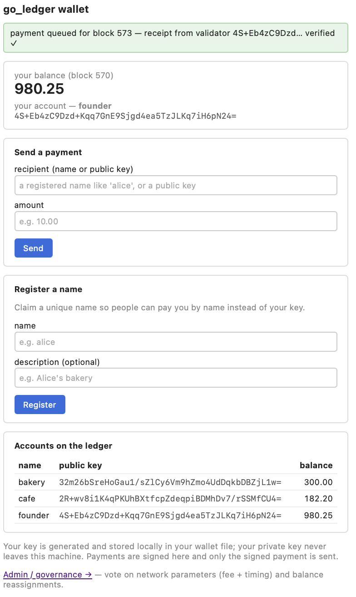
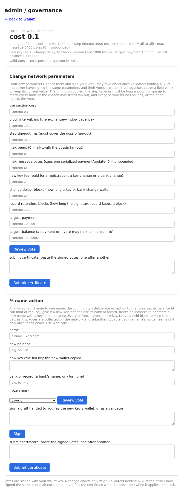

# go_ledger — a distributed ledger in a single static binary

A Byzantine-fault-tolerant ledger in which **names are the accounts**: you register a name at your
bank, pay people by name, and look names up on-chain. Validators are the banks, each with the
voting power the genesis gives it (or, in the optional dynamic mode, the stake delegated to it).
Everything, the validator node, its public face, its signer and the wallet, builds with
`go build`, with **no runtime and no third-party dependencies**: Tendermint-style ⅔ commit safety,
post-quantum ML-DSA-65 signatures, exact decimal money, ⅔ governance, and a browser wallet, in a
codebase small enough to read. It descends from the original Hypernode ledger (see [Origins](#origins)).

## Try it in one command

    make demo

This starts a one-validator network on this machine, with three funded names (`founder`, `bakery`,
`cafe`), and the wallet with its admin page, and prints their addresses. Pay a name, vote a fee
change, or start the second wallet the demo prints and register a new name at the founder's bank.
Ctrl-C stops it.

## Try four banks in containers

    make quickstart

This builds the container images, writes a new network of four banks into `deploy/quickstart/`
(their keys, sealed, the genesis, and the configs and secrets of their engines and signers), and
starts it with Docker Compose: each bank is an engine, a signer that holds its key, a fetcher, its
public face, and the bank's own wallet. The public faces are on this machine at
`http://127.0.0.1:18081` to `http://127.0.0.1:18084`, and the banks' wallets at
`http://127.0.0.1:18091` to `http://127.0.0.1:18094`, under any user name and the password the
quickstart wrote for each, such as `deploy/quickstart/bank-a.wallet.password`. To pay as `alice`, one
of the two funded customers the quickstart makes:

    make build
    bin/go_ledger_ui -node http://127.0.0.1:18081 -network quickstart -wallet deploy/quickstart/alice.wallet.json -listen 127.0.0.1:8090

and open `http://127.0.0.1:8090`. `make quickstart-clean` removes the network, its chain and its
keys. Podman, the ports, and what a wallet on this machine cannot check are in
[the runbook](docs/operating-a-network.md#four-banks-on-one-machine-the-quickstart).

## Design goals

- **No JVM, no dependencies.** One static binary per command (`make build` sets `CGO_ENABLED=0`),
  easy to run on old hardware: the first target is a handful of laptops on a local intranet.
- **Small and auditable.** The rules are pure packages with no I/O, so each can be read and tested
  on its own.
- **Separate executables.** The node and the wallet are separate programs and Go modules; the wallet
  lives under [`ui/`](ui/) and can move to its own repository once the root module is published:
  drop the `replace` in `ui/go.mod` and require that version.

## Status

A runnable, race-free, multi-node ledger, the Go port of the Java Hypernode engine, hardened by
several review rounds: the 2026-07 security audit and a release-candidate pass
([`findings.md`](findings.md)), and the post-eMudhra review of 2026-10-27
([`findings_20261027.md`](findings_20261027.md)). Its fixes came in phases. Phase 1 fixed what
needed no new genesis. Phase 2, built by 2026-10-31, is one new genesis:

- **ML-DSA-65** is the only signature scheme, and the network id is bound to the genesis.
- **Names are the identity.** A name is registered at a bank: the requestor pays the fee, the bank
  co-signs and becomes the name's bank of record, and the new key proves its holder has it. Payments,
  delegations and validator seats are by name; paying to a raw key is gone.
- **Key changes, bank changes and the freeze.** A key change (a sale too) needs the holder, its
  bank and the new key; a bank change needs the holder and the new bank; both wait about a day. The
  holder can freeze the name at once, for free. A frozen name neither pays nor is paid.
- **A double-sign freezes the name** and takes no money; the ⅔ decide about the money.
- **The ⅔ name action** re-keys, freezes, unfreezes, sets a balance or a bank of record, or creates a
  name.
- **Plain-decimal amounts and caps** on a single payment and on a balance, as ⅔-governed parameters.
- **Each block hash covers its body, its signing set and a random nonce**, and proposals sign it.
- **The signature record** keeps who signed each block for `retainBlocks` heights, and every
  governance certificate and double-sign proof for life. It never keeps payments.
- **The idle chain**: a height starts at once when there is work, and otherwise after a five-minute
  heartbeat, so a network nobody uses commits, signs and records one empty block about every five
  minutes, and a wallet can tell an idle chain from a stalled one.
- **The fork-binding pin** binds a payment to the full state digest its block builds on.

The Phase 2 build record, its spec and the code notes are in [`review/`](review/README.md); start
with [`review/phase2_progress.md`](review/phase2_progress.md). Phase 2 and the fixes from its final
read-through were built and checked by 2026-10-31. What the owner decided, and what is still a
builder default, is in the spec's [§12](review/phase2_spec.md#12-open-questions-for-the-owner).

Phase 3, built on 2026-11-01, is another new genesis. It splits the deployment, and keeps the
network going when the internet does not:

- **Two ports.** A bank's engine serves the other validators on a gossip port, behind an allow
  list of the validators' IP addresses, which it reads from the chain. It serves the bank's own
  machines on an operator port, which is never published.
- **The public face.** The engine writes the files the public reads: the status, the checkpoint,
  the accounts, governance, a record per name and the public bundle. A small fetcher
  (`cmd/fetcher`) serves them, with the signature record, behind a CDN, and passes customers'
  payments, updates and name requests on to the engine.
- **Names as a name service.** Every name may publish a public address and up to 4 IP addresses,
  which its own key signs. A validator's IP addresses are where gossip goes, and where it may come
  from.
- **Pigeon mode.** When the network is cut, the banks carry signed messages by hand in bundles,
  carry checkpoints to banks that fell behind, and turn on a slow-down switch that lets each round
  wait for the carrier. Where direct gossip is blocked but the public faces still get through, the
  engines pull each other's public bundles on their own.
- **Containers and the quickstart.** Images for the engine and the fetcher, and for the wallet, and
  a compose file that runs four banks on one machine (`make quickstart`).

The Phase 3 spec is [`review/phase3_spec.md`](review/phase3_spec.md), and its build record
[`review/phase3_progress.md`](review/phase3_progress.md).

Phase 4, built by 2026-11-03, is another new genesis. It takes the key off the networked machines,
lets DNS and firewalls read the names, and lets a joining node trust no single peer:

- **The signer.** A bank's one key lives in the signer (`cmd/signer`), sealed at rest, on the bank's
  private network. The engine and the bank's wallet hold the public key only, and ask it for each
  signature, each as a client with its own secret and its own list of domains. It gives each vote
  and proposal slot one signature, written to disk before it signs, and keeps an audit log.
- **The name service.** The engine writes the names as a DNS zone file, with the validators'
  addresses as an IP filter, and a lookup from an IP address to the names that list it, so a bank
  can tell whom to call about a flood. A name may list its web server's TLS keys, and a wallet takes
  from a bank's web server only a key the bank lists.
- **The joiner.** A node takes a checkpoint only when more than ⅔ of the validator set it trusts
  signed it, walks from set to set where the set changed (each block names the set that signs the
  next), asks every validator, and stops with an alarm when two valid commits disagree.

The Phase 4 spec is [`review/phase4_spec.md`](review/phase4_spec.md), and its build record
[`review/phase4_progress.md`](review/phase4_progress.md). What is left to do is in
[`TODO.md`](TODO.md). The words and the finding ids (A1, C1, E1, Q1, R1 and the rest) are explained
in [`docs/glossary.md`](docs/glossary.md).

The real gate before value rides on it is an independent **human** audit: an AI review is an input,
not a substitute. Why the project stays small:
[`docs/why-small-and-auditable.md`](docs/why-small-and-auditable.md).

The docs are in [`docs/`](docs/), in four areas: signature, node, API/CDN and UI. Just as important
as the code is [**managing the currency**](docs/managing-the-currency.md): the monetary policy of a
community currency, where taxes and minting pay the public sector and the fee only prices the
network's work, and its honest limits.

## Layout

| Package | Area | What it holds |
|---|---|---|
| `signing/` | signature | ML-DSA-65, the signing domains, and the preimage every signature binds |
| `cmd/keygen/` | signature | prints a fresh key pair, writes one into a sealed key file, or prints a client secret for the signer |
| `cmd/signer/` | signature | holds a bank's key, and signs for the bank's engine and wallet, by its rules |
| `consensus/` | node | the validator set, votes, the commit, signed proposals, double-sign evidence, the round driver |
| `ledger/` | node | the state, the messages, the ⅔ certificates, the genesis, `ProposeBlock` and `ApplyBlock`; no I/O |
| `node/` | node, API/CDN | the running node: event loop, pools, snapshot and sign log, catch-up, the signature record; its HTTP routes, relay and peers |
| `cmd/server/` | API/CDN | runs one node, the engine, from a config file and a genesis file: the gossip port and the operator port |
| `cmd/fetcher/` | API/CDN | a bank's public face, the origin of its CDN: serves the files the engine writes, and passes customers' messages on |
| `cmd/demo/` | API/CDN | runs one node and one wallet on this machine |
| `cmd/quickstart/` | API/CDN | writes a network of four banks for `deploy/compose.yaml` |
| `deploy/` | API/CDN | the container images and the quickstart's compose file |
| `ui/` | UI | the wallet, its own Go module |
| `docs/` | | the docs, in the four areas |

The imports run `signing` → `consensus` → `ledger` → `node` → `cmd/server`, `cmd/demo` and `ui`;
`cmd/keygen` imports only `signing`, `cmd/signer` only `signing`, `consensus` and `ledger`,
`cmd/fetcher` only `ledger`, and `cmd/quickstart` only `ledger` and `signing`. To read the code in that order, one step at a time with each
step's tests, follow [`docs/reading-the-code.md`](docs/reading-the-code.md).

## Audit invariants enforced in `ledger`

From the 2026-07 security audit:

- **B1**: a negative-amount payment cannot mint to the payer.
- **B2**: a payment from a name that does not exist cannot mint to the payee.

`ledger.ProcessPayments` moves value only for a payment of at least the transaction cost, never a
negative one, between two names that exist. Money is exact (`math/big.Rat`); there is no floating
point anywhere in the money path.

## Signatures

The audit's central finding (C1): one unscoped key signing every payload over bare `:`-joined
strings lets a signature made in one context be replayed as a payment. The `signing` package rules
that out by construction:

- `Signer`, the only signing API the node and the wallet use, has **no "sign raw bytes" call.**
  Every signature is scoped to a domain (`payment`, `account-update`, `registration`,
  `block-revision`, …).
- The signed preimage is **length-prefixed** and binds a protocol tag, the **network id**, the
  domain and each field, so field boundaries cannot shift (C7), and a signature cannot cross
  domains (C1) or networks (C6). The network id is made from the genesis hash.
- The scheme is **ML-DSA-65** (FIPS 204), from Go's standard library `crypto/mldsa`: 1952-byte
  public keys, 3309-byte signatures, keys stored as their 32-byte seed. Signing is deterministic.
  `keygen` prints a fresh pair, or writes it into a key file sealed with a passphrase.
- A bank's key can live in the **signer** (`cmd/signer`): it signs only the domains each client's
  list allows, only in the bank's own name, and never two different votes for one height, round and
  type.

The tests check that the replays fail: a `receipt` signature does not verify as a `payment`, a
`testnet` signature does not verify on `mainnet`, and re-splitting a field's bytes does not verify.
See [`docs/signature.md`](docs/signature.md).

## Cryptographic agility

The signature scheme is a whole-network choice fixed at genesis: every node must verify exactly as
every other does. Phase 2 changed it from Ed25519 to ML-DSA-65, at a new genesis. A later change
works the same way, without losing the ledger: agree a height, capture the committed state, have
everyone make new keys, write a new genesis from the captured state under a new network name, and
start the network again. The money supply and every balance carry over; the keys and the network
id change, and frozen marks and pending changes do not carry over. It is a planned outage of hours,
and a decision the community owns (see
[`docs/operating-a-network.md`](docs/operating-a-network.md#starting-a-new-network)).

In the code, the scheme is the three files `signing/mldsa65*.go`: the scheme, its tests and its build
guard. Its type is unexported, so no other package can name it; the rest of the code reaches it only
through the `signing.Scheme` interface and `signing.NetworkScheme()`, and the message-size floor and
default follow its signature size. To change the scheme, replace those files with ones that implement
`Scheme` and define `NetworkScheme`, and update the two comments in `scheme.go` that name the
implementations. `Scheme`'s comment says what a scheme must do, and the signing tests check the new one
against it. Among those duties, `ValidatePublicKey` says which public keys the scheme accepts: the
right size, decodable, and not degenerate, as the scheme defines it (a second encoding of a key, or
the weak keys it refuses: for ML-DSA-65 the most degenerate ones, a sanity check whose limits
[docs/signature.md](docs/signature.md) states). Every key that
enters, from the genesis, a node's config, the wallet or a request, passes it, and `Verify` refuses
every key it refuses. Ed25519, ML-DSA-87 and a stand-in with 20000-byte signatures, each swapped in for
the three files with nothing else changed, passed the whole suite; the Ed25519 file refuses Ed25519's
weak and non-canonical keys, with tests of its own (`review/_evidence_phase2/scheme-drop-in/`).
A scheme much slower, or with keys and signatures much larger, would need its timing and the byte
bounds listed in `Scheme`'s comment rechecked.

## Consensus

The audit's central consensus finding (A1, A4): finalising on "more than ½ of all stake" in one
node's local view lets a coalition under ½ fork the chain under a partition, and the value voted on
was not the value applied (A2). The `consensus` package fixes this:

- **Finalisation needs > ⅔ of the power**, precommitting one block hash. Any two such quorums
  overlap in an honest validator, who precommits at most one block in a round, so two conflicting
  blocks cannot both commit in one round while at most ⅓ is Byzantine.
- **The block hash covers the applied state**, the content, the signing set and the proposer's
  nonce. Every node re-runs the block and takes it only if it gets the same state.
- **A round driver with locking** (`Driver`): prevote, precommit, a lock, and timeouts that grow
  with the round. The lock keeps it safe across rounds, and the timeouts make it live. It is a pure
  state machine, tested without clocks.
- **A double-sign freezes the name**: two signatures by one name for different block hashes in one
  slot are a proof a later block carries.

The `node` package runs it all in one event loop per node, race-free by construction. An adversarial
harness, a deterministic driver simulator and a fault-injecting chaos suite (partitions, loss,
reorder, double-signers), holds *no fork* and *no silent mint* across thousands of random schedules.
See [`docs/consensus.md`](docs/consensus.md) and [`docs/architecture.md`](docs/architecture.md).

## Build & test

    go test -short ./...            # fast: skips the chaos scenarios, runs fewer simulator seeds
    go test -race ./...             # full, as CI runs it
    go test -C ui -race ./...       # the wallet module
    make build                      # the six programs into bin/, static (CGO_ENABLED=0)
    make images                     # the container images (CONTAINER=podman for Podman)

Requires Go 1.27 or later. A chaos run prints a `GOLEDGER_CHAOS_SEED` that replays its fault
schedule; `GOLEDGER_CHAOS_SOAK_SECONDS` lengthens the random soak, `GOLEDGER_SIM_SEED_FACTOR` scales
the simulator's seeds, and `GOLEDGER_CHAOS_SLACK` stretches the tests' deadlines on a slow machine
(CI sets 4).

## Money

Amounts are exact rationals (`*big.Rat`) on a fixed grid: a whole number of 0.00000001 units. They
are read only as plain decimals, 1 to 18 digits and up to 8 decimals (`12`, `0.5`), and written in
one canonical form, as JSON strings. A sign, an exponent, a fraction like `1/2`, or anything finer
than the grid is refused before a number is built. Two ⅔-governed caps bound a single payment and a
balance.

## Origins

`go_ledger` is **not** an original work. It is a **Go port of the original Hypernode distributed
ledger, a Java (JVM) project** — a from-scratch, deliberately small delegated-proof-of-stake ledger
with a consensus-backed naming registry. The design, consensus model, naming registry, and
governance mechanism all originate in that Java implementation; this repository re-implements them in
Go (dropping the JVM for a single static binary) and hardens them, but all credit for the original
design belongs upstream:

> **Original project (Java):** <https://github.com/JauntyJackalope351/hypernode-ledger> — *Hypernode
> distributed ledger, AGPL-3.0.*

The original Java project is not part of this repository and stays as it is. This repository is a derivative work and is
likewise licensed **AGPL-3.0** (see [`LICENSE`](LICENSE)), as the original's copyleft requires.

